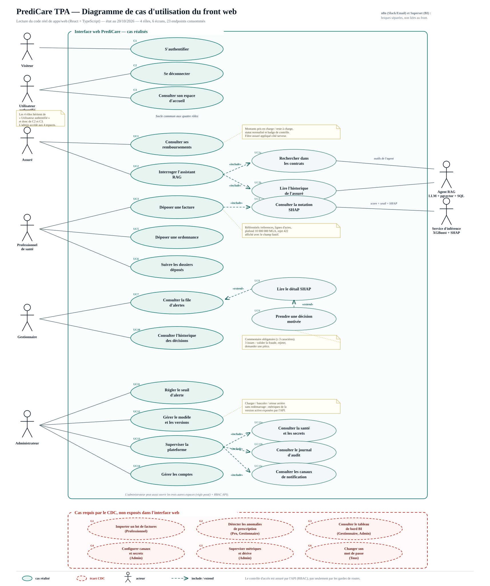

# PrediCare TPA — Analyse du front web et comparaison au cahier des charges

> **Périmètre** : `apps/web` (React 18.3 + TypeScript 5.7 + Vite 6 + React Router 6), les contrats API qu'il consomme, et le comportement des services `api-core`, `api-rag` et `api-inference` lorsqu'il conditionne un écran.
>
> **Date de l'analyse** : 20/10/2026.
>
> **Version** : 2 — mise à jour après les commits `40d14cb` (gestion des comptes), `46387b5` (montants de remboursement) et **exécution réelle de la stack locale** le 20/10/2026 à 09:50.
>
> **Méthode** : lecture du code réel **puis vérification en exécution** — `scripts/verifier_back_front.ps1` (24 contrôles), build et typecheck du front, suite `pytest` (605 tests), matrice RBAC HTTP et requêtes SQL de contrôle. Le détail figure en § 4.4 et en annexe C.
>
> **Livrables associés** :
> - diagramme : [`uml/cas_utilisation_front.svg`](uml/cas_utilisation_front.svg)
> - source éditable : [`uml/cas_utilisation_front.puml`](uml/cas_utilisation_front.puml)

> **Mise à jour du 20/10/2026 (soir)** : la chaîne RAG a été rétablie
> (image `api-rag` alignée, clés réelles, 470 segments indexés). L'onglet
> Assistant envoie désormais un `session_id`, affiche les extraits et scores
> de sources, la trace des outils et les indicateurs FinOps. Les constats
> § 0.3, § 0.10 et G10 décrivent l'exécution du matin et sont conservés comme
> historique ; les lignes F05, F06 et F08 sont mises à jour. Le plan de test
> courant est [`plan_de_test_back_front.md`](plan_de_test_back_front.md).

---

## 0. Synthèse

1. Le front n'est **pas une maquette** : c'est une application à 4 rôles, 6 écrans, 23 endpoints consommés, avec un client HTTP unique, des gardes de routes et un contrôle d'accès réel côté API.
2. Il couvre bien la condition **« Utilisable »** du CDC : une interface unique, une connexion, quatre parcours sans ligne de commande. Les six routes répondent en 200 sur l'instance déployée.
3. Il couvre le **Flux 1** jusqu'à l'affichage du score et du rapport SHAP. En revanche, le **Flux 2 (assistant RAG) est codé mais non opérationnel** sur l'instance vérifiée : `POST /api/rag/question` renvoie **500**, et la table `core.document_vectorise` contient **0 ligne**.
4. Il ne couvre **pas le Flux 3** : le tableau de bord BI (Superset) existe, mais aucun lien ni écran ne le rend accessible depuis l'application.
5. Il ne permet **pas d'importer un lot de 20 factures** : le professionnel saisit une facture à la fois dans un formulaire.
6. La **détection des anomalies de prescription** n'existe pas comme cas d'utilisation : le formulaire d'ordonnance est trop pauvre pour alimenter les features du modèle, et aucune alerte dédiée n'est produite.
7. Les **canaux de notification** et les **secrets** sont en lecture seule ; le seuil, le modèle et les comptes sont, eux, réellement administrables.
8. Le **journal d'audit** est affiché, mais il n'est pas alimenté automatiquement : après la campagne de test, il contient **une seule entrée** (`test_plan`), alors que 7 décisions et plusieurs connexions ont eu lieu.
9. Sur les **22 exigences du CDC ayant une traduction attendue dans l'interface**, 11 sont pleinement couvertes, 4 partiellement et 7 absentes, soit environ **59 % de couverture visible** (mise à jour RAG du 20/10 au soir).
10. Les risques les plus visibles pour un jury sont : le professionnel voit **toutes** les factures (83 dossiers distincts sur les 100 premières lignes), l'en-tête admin affiche **« Version 2 / Seuil 28,76 % » en dur**, une facture contrôlée reste **« En vérification »** pour l'assuré même après décision, et l'assistant RAG tombe en **erreur 500**.
11. Les tests automatiques sont néanmoins solides : **24 OK / 0 KO** sur le script back/front, **0 erreur** de typecheck, **build Vite réussi**, et **586 tests pytest sur 605** au vert (1 échec lié aux fins de ligne Windows, 18 ignorés).


---

## 1. Architecture réelle du front

| Élément | Réalité constatée | Fichier |
| --- | --- | --- |
| Framework | React 18.3, React Router 6.28, Vite 6, TypeScript 5.7 | `apps/web/package.json` |
| Point d'entrée | `main.tsx` monte le Router et `AuthProvider` | `src/main.tsx` |
| Routes | `/connexion` publique ; `/`, `/assure`, `/professionnel`, `/gestionnaire`, `/administration` protégées | `src/App.tsx` |
| Gardes | `RequireAuth` puis `RequireRole` ; l'administrateur hérite de tous les droits | `components/Guards.tsx`, `auth/AuthContext.tsx` |
| Client API | Un seul `fetch`, jeton `sessionStorage`, erreurs typées `ApiError`, déconnexion globale sur 401 | `api/client.ts` |
| Contrats | Types recopiés à la main depuis les schémas Pydantic (pas de génération automatique) | `api/types.ts` |
| Navigation | Accueil + un espace par rôle ; l'admin voit les quatre espaces | `components/Shell.tsx` |
| Style | Une feuille CSS unique, aucune police ni icône externe (CSP) | `src/styles.css` |
| Déploiement | Build statique servi par nginx, une seule origine `/api` derrière Traefik | `apps/web/Dockerfile`, `nginx.conf`, `apps/web/README.md` |

**Conséquence de conception** : le front ne décide de rien sur les droits. Il masque les écrans, mais l'API re-vérifie chaque requête. C'est le bon choix, et c'est explicitement documenté dans `Guards.tsx` et le README.

### 1.1 Les six écrans

| Écran | Route | Onglets / zones | Rôle |
| --- | --- | --- | --- |
| Connexion | `/connexion` | formulaire + comptes de démonstration cliquables | public |
| Accueil | `/` | espace du rôle, droits, parcours d'une facture | tous |
| Mes remboursements | `/assure` | Remboursements, Assistant | assuré |
| Espace professionnel | `/professionnel` | Déposer une facture, Suivi des dossiers, Ordonnance | professionnel de santé |
| File d'alertes | `/gestionnaire` | À traiter, Historique | gestionnaire |
| Administration | `/administration` | Seuil, Modèle, Santé, Canaux, Comptes, Journal | administrateur |

---

## 2. Ce que chaque rôle peut réellement faire

### 2.1 Assuré

| Action | Écran | Endpoint | Constat |
| --- | --- | --- | --- |
| Voir ses factures et remboursements | Remboursements | `GET /api/core/factures?limit=100` | Tableau avec date, prestataire, montant, pris en charge, reste à charge, statut, badge de contrôle. Le filtre par assuré est appliqué **côté serveur** (`billing/router.py`, lignes 275-285). |
| Voir l'état du contrôle | Remboursements | même endpoint | Badge `En vérification` si `is_fraud = true`, `Clair` si `false`, `Non contrôlé` si `null`. |
| Poser une question sur ses garanties | Assistant | `POST /api/rag/question` | Chat à onglets, sources citées, latence et indicateur de cache. **Test du 20/10 : réponse 500** (`invalid input syntax for type vector`) ; l'onglet affiche le message technique « Erreur interne… (500) ». |
| Changer son mot de passe | — | `POST /api/core/auth/password` existe | **Aucun écran ne l'expose.** |

Limites visibles :
- 100 factures maximum, sans pagination ni filtre : l'assuré de démonstration en a **28**, toutes correctement filtrées côté serveur ;
- aucune page de détail de facture ;
- `montant_eligible` est exposé par l'API mais **n'est pas affiché** (seuls « pris en charge » et « reste à charge » le sont) ;
- l'assistant ne conserve pas le contexte entre deux questions (l'historique vit dans l'état React de l'onglet) ;
- `etapes_agent`, `tokens` et l'indicateur de cache sémantique sont renvoyés par l'API mais seuls la latence et le booléen de cache sont affichés ;
- **l'assistant est aujourd'hui inutilisable** : voir G10 pour la cause exacte et la correction.

### 2.2 Professionnel de santé

| Action | Écran | Endpoint | Constat |
| --- | --- | --- | --- |
| Charger les référentiels | Dépôt | `GET /api/core/factures/references` | 50 assurés, 100 prestataires, 200 actes maximum, en pseudonymes. |
| Composer une facture | Dépôt | — | Sélection assure/prestataire, date, lignes d'actes (code, quantité, montant, date), total calculé en direct, plafond 10 000 000 MGA. |
| Soumettre et noter | Dépôt | `POST /api/core/factures/soumettre` | Réponse 202 avec score, seuil, version du modèle, SHAP. |
| Lire l'explication SHAP | Dépôt | même endpoint | Barres SHAP, sens de contribution et libellé métier. |
| Suivre les dossiers | Suivi | `GET /api/core/factures?limit=100` | **Affiche toutes les factures de la base, pas seulement celles du praticien connecté** (voir § 5, écart G7). |
| Déposer une ordonnance | Ordonnance | `POST /api/core/factures/ordonnances` | Un seul acte, une date, une quantité. Pas de diagnostic, pas de validité, pas de lignes multiples. |

Le formulaire est fonctionnel, mais il reste un **formulaire de démonstration** : aucune pièce jointe PDF, aucun OCR, aucun import de fichier, aucun brouillon, aucun lien entre la facture déposée et une ordonnance existante.

### 2.3 Gestionnaire

| Action | Écran | Endpoint | Constat |
| --- | --- | --- | --- |
| Voir la file | À traiter | `GET /api/core/alertes/file?statut=nouvelle&limit=100` | Score, montant, pseudonyme, date. |
| Ouvrir une alerte | Détail | `GET /api/core/alertes/detail/{prediction_id}` | Score, facture, montant, rapport SHAP. |
| Décider | Détail | `POST /api/core/alertes/decision` | Trois issues : `valider_fraude`, `rejeter`, `demander_piece`. Commentaire obligatoire (≥ 3 caractères). |
| Relire l'historique | Historique | `GET /api/core/alertes/historique?limit=200` | Date, alerte, décision, score, commentaire. |

Limites visibles :
- 100 alertes maximum, sans pagination ni tri ;
- le choix de décision **reste mémorisé** quand on change d'alerte (risque de valider une fraude par inadvertance) ;
- aucune confirmation avant `Confirmer la fraude` ;
- la décision met à jour `ml.prediction.statut`, **pas** `core.facture.statut` : l'assuré ne voit jamais l'issue.

### 2.4 Administrateur

| Onglet | Action | Endpoint |
| --- | --- | --- |
| Seuil | Lire et modifier le seuil, avec motif | `GET/PUT /api/core/admin/seuil` |
| Modèle | Lire la version active, les métriques, charger une candidate, basculer, revenir en arrière | `GET /api/core/admin/modele`, `POST /model/candidat`, `/bascule`, `/retour-arriere` |
| Santé | Base, inférence, RAG, version, seuil, secrets manquants | `GET /api/core/admin/sante` |
| Canaux | Lister Slack et e-mail | `GET /api/core/admin/canaux` |
| Comptes | Lister, créer, activer/désactiver | `GET/POST /api/core/admin/utilisateurs`, `PATCH /{id}` |
| Journal | Lire les 200 dernières entrées | `GET /api/core/audit/journal?limit=200` |

Limites visibles :
- l'en-tête de la page affiche **« Version : 2 »** et **« Seuil : 28,76 % » codés en dur** (`AdminPage.tsx`, lignes 216-217), alors que le README interdit les valeurs en dur ;
- les canaux sont en lecture seule : l'API renvoie `slack-gestionnaires` avec `actif: true` et `destinataire: "non-configure"`, ce que l'écran affiche tel quel (badge vert + destinataire absent) ;
- l'onglet **Santé** affiche `rag: ok` alors que l'assistant renvoie 500 : la sonde ne teste que `/health`, pas la chaîne d'embedding, et `secrets_manquants` est vide alors que la clé d'embedding vaut encore `CHANGER_MOI_LLM` ;
- aucune action sur les secrets, les métriques, la dérive ou les sauvegardes ;
- aucun écran ne permet de poster un événement d'audit.

---

## 3. Diagramme de cas d'utilisation



**Lecture du diagramme**

- les ellipses vertes sont les cas **réalisés** dans `apps/web` ;
- les ellipses rouges pointillées sont les cas **requis par le CDC mais absents** de l'interface ;
- les acteurs de droite sont des **acteurs secondaires** (services) : l'agent RAG et le service d'inférence ;
- `n8n` (Slack/Email) et `Superset` (BI) existent dans le dépôt, mais restent **hors du parcours web** : ils ne sont donc pas représentés comme acteurs du front, et apparaissent dans la zone des écarts ;
- la mention rouge sous le titre rappelle le **résultat d'exécution du 20/10/2026** : 24 OK / 0 KO et build vert, mais assistant RAG en erreur 500 (G10).

**Ce que le diagramme met en évidence**

1. Le socle commun (authentification, déconnexion, accueil) est correctement factorisé.
2. Les parcours assuré, professionnel et gestionnaire sont linéaires et lisibles.
3. L'administration est le bloc le plus riche : 7 cas réalisés, dont 3 inclus dans « Superviser la plateforme ».
4. Les écarts CDC sont concentrés sur trois zones : **import de lot**, **prescriptions**, **pilotage/observabilité**. Ce sont des cas métier, pas des détails techniques.

---

## 4. Comparaison au cahier des charges

### 4.1 Couverture des exigences ayant une traduction dans l'interface

Légende : **✔** couvert, **◐** partiel, **✖** absent.

| ID | Exigence du CDC | Ce que fait réellement le front | Verdict |
| --- | --- | --- | --- |
| F01 | Interface web unique, connexion, 4 rôles (condition « Utilisable ») | 6 écrans, 4 espaces, routes gardées, RBAC serveur | ✔ |
| F02 | Automatiser le contrôle des factures | Scoring synchrone à la saisie ; pas d'import, pas de re-contrôle d'un stock existant | ◐ |
| F03 | Détecter les anomalies financières en temps réel avec explicabilité | Score, seuil, version et SHAP affichés au professionnel et au gestionnaire | ✔ |
| F04 | Détecter et alerter les anomalies de prescription (doublons, inadéquation diagnostic) | Formulaire d'ordonnance minimal ; aucune détection ni alerte dédiée | ✖ |
| F05 | Assistant conversationnel RAG sécurisé | Onglet complet (sources, extraits, session, latence, cache) et garde-fous présents ; chaîne rétablie le 20/10 au soir. Réserve : p95 6,19 s > 5 s | ✔ |
| F06 | Agent autonome (ReAct) interrogeant RAG et SQL | L'agent existe (2 outils) et l'interface affiche les étapes, statuts et durées | ✔ |
| F07 | Flux 1 complet : facture → inférence → SHAP → stockage → n8n → Slack | Le web s'arrête à l'affichage ; n8n est un circuit séparé, avec un seuil différent | ◐ |
| F08 | Flux 2 : assuré → agent → contrats + SQL → LLM → réponse sourcée | Chaîne opérationnelle de bout en bout : sources citées, SQL, suivi de session, injection refusée ; p95 6,19 s | ✔ |
| F09 | Flux 3 : dashboard BI temps réel (volumes, économies, taux de détection) | Superset existe, aucun lien ni écran dans le front | ✖ |
| F10 | Seuil d'alerte modifiable sans redémarrage | Onglet Seuil + motif, propagation au service d'inférence | ✔ |
| F11 | Canaux de notification modifiables sans code | Lecture seule ; badge `actif` trompeur si le webhook est absent | ✖ |
| F12 | Secrets modifiables sans code | Liste des secrets manquants, aucune écriture | ◐ |
| F13 | Supervision via `/health` | Onglet Santé : base, inférence, RAG, version, seuil, secrets — mais la sonde RAG est un faux positif (voir G5) | ✔ |
| F14 | Journaux, métriques de latence, volume, erreurs, dérive | Rien dans le front ; Prometheus/Grafana et `/api/inference/derive` existent à côté | ✖ |
| F15 | Modèle versionné, mise à jour et retour arrière sans interruption | Charger la candidate, basculer, revenir à une version | ✔ |
| F16 | Rejet propre des factures invalides | Pré-contrôles front + 422 serveur avec champ fautif affiché | ✔ |
| F17 | Lot de 20 factures inédites fourni par le jury | Un formulaire, une facture à la fois ; aucun import CSV/JSON/PDF | ✖ |
| F18 | Guide utilisateur | Aucune aide en ligne ; `docs/utilisateur/README.md` est encore un brouillon TODO | ✖ |
| F19 | Authentification et rôles, contrôle d'accès | Gardes front + `ensure_role`/`ensure_permission` côté API | ✔ |
| F20 | Journal d'audit | Écran présent, mais décisions et actions admin non journalisées automatiquement | ◐ |
| F21 | Pseudonymisation des données de santé | Pseudonymes à l'écran, aucune identité, filtre assuré serveur | ✔ |
| F22 | Changement de mot de passe | Endpoint disponible, aucun écran | ✖ |

**Décompte** : 8 ✔, 7 ◐, 7 ✖ sur 22 exigences UI. En comptant les partiels pour moitié, la couverture visible est de **11,5 / 22 ≈ 52 %**. La baisse par rapport à la version statique (10 ✔ / 57 %) vient de la vérification en exécution du Flux 2 : l'interface existe, mais la chaîne RAG ne répond pas.

### 4.2 Les conditions « exploitable » qui ne sont pas des écrans

| Condition CDC | Réalité | Où |
| --- | --- | --- |
| Déployable | `docker compose up` avec le service `web` | `docker-compose.yml`, `apps/web/Dockerfile` |
| Persistante | PostgreSQL + migrations + sauvegarde scriptée | `db/migrations`, `ops/backup` |
| Configurable | Seuil : oui ; canaux/secrets : partiel | `admin/router.py`, `.env` |
| Supervisable | `/health` par service, Prometheus/Grafana, dérive exposée | `ops/prometheus`, `ops/grafana`, `api-inference/router.py` |
| Maintenable | Registre de modèles, bascule, retour arrière, CI | `admin/router.py`, `.github/workflows` |
| Robuste | Validation stricte et messages par champ ; pas de lot | `packages/predicare-core/src/predicare/schemas.py` |
| Documentée | Guides d'exploitation présents ; guide utilisateur TODO | `docs/exploitation`, `docs/utilisateur` |

Ces conditions sont **remplies ailleurs que dans le front** : c'est acceptable pour l'exploitation, mais cela contredit partiellement l'idée d'« interface unique comme point d'entrée de tous les utilisateurs » dès qu'on parle de pilotage et de supervision.

### 4.3 Le cas du Flux 1 et du seuil : deux circuits, deux seuils

Le CDC écrit : *« Score > 0.8 → notification Slack au gestionnaire avec rapport d'explicabilité »*.

Le dépôt implémente **deux chemins distincts** :

1. **Chemin web** : `POST /api/core/factures/soumettre` → `api-core` → `api-inference` → score et SHAP → persistance `ml.prediction` → file du gestionnaire. Le seuil appliqué est celui du modèle, environ **0,2876** (28,76 %), choisi pour maximiser le rappel. Ce choix est documenté et assumé dans `.env.example` (lignes 84-98) : le seuil historique de 0,8 laissait passer trop de fraudes.
2. **Chemin n8n** : `PK-Alerte-Fraude.json` appelle directement `/api/inference/predire`, compare le score à `SEUIL_ALERTE`, qui vaut **0,8 par défaut** dans `docker-compose.yml` (ligne 579), puis notifie Slack.

Conséquences :
- le seuil du CDC et le seuil du modèle ne sont pas le même ; c'est défendable, mais **il faut l'expliquer au jury** ;
- le workflow n8n n'est **pas déclenché par le parcours web** : le front n'envoie rien à n8n, et l'écran d'administration ne fait que lire les canaux ;
- le workflow semble par ailleurs fragile : il éclate le tableau `lignes` **avant** de tester `montant_total`, et son premier test porte sur le montant, pas sur le score. À revalider en exécution avant de le présenter comme la brique d'alerte.

### 4.4 Vérification par l'exécution (20/10/2026, 09:50)

Stack Docker locale : 8 conteneurs démarrés, dont 7 `healthy` (la gateway n'a pas de sonde), gateway sur `:8080`, front sur `:8081`.

| Contrôle | Commande | Résultat |
| --- | --- | --- |
| Parcours back/front | `scripts/verifier_back_front.ps1` | **24 OK / 0 KO** : 4 connexions, 12 GET, contrôles d'isolation et de montants, soumission `202`, détail et décision `200`, prédiction `11 → 12` |
| Typecheck front | `npm run lint` (`tsc --noEmit`) | **0 erreur** |
| Build front | `npm run build` | **OK** — 45 modules, JS 215,64 kB (gzip 67,58), CSS 11,77 kB, 759 ms |
| Tests backend | `pytest tests` (hors e2e) | **605 tests : 586 réussis, 18 ignorés, 1 échec** |
| Routes SPA | `GET /connexion`, `/`, `/assure`, `/professionnel`, `/gestionnaire`, `/administration` | **200** sur les six |
| Assistant RAG | `POST /api/rag/question` | **500** (`invalid input syntax for type vector`) |
| Base | `SELECT count(*)` | 84 605 factures, 12 prédictions, 60 SHAP, 7 décisions, 4 comptes, **1 entrée de journal** |

**Matrice RBAC observée** (jetons réels, pas de simulation) :

| Requête | Rôle | Attendu | Observé |
| --- | --- | --- | --- |
| `GET /alertes/file` | assuré | 403 | **403** |
| `GET /admin/seuil` | professionnel | 403 | **403** |
| `GET /admin/utilisateurs` | gestionnaire | 403 | **403** |
| `GET /audit/journal` | assuré | 403 | **403** |
| `GET /factures` | anonyme | 401 | **401** |
| `GET /factures` | admin | 200 | **200** |
| `GET /factures` | gestionnaire | 200 | **200** |

**Ce que l'exécution confirme** :

- l'isolation de l'assuré est réelle : 28 factures, **un seul pseudonyme**, identique au `COUNT(*)` SQL ;
- le professionnel reçoit **100 lignes couvrant 83 dossiers distincts** : G7 est confirmé, ce n'est pas une déduction de lecture ;
- les prédictions 8 et 9 sont passées à `valider_fraude` alors que leurs factures sont toujours `recue` : G8 est confirmé en base ;
- `audit.journal` ne contient qu'une ligne `test_plan` malgré 7 décisions et plusieurs connexions : G6 est confirmé ;
- l'API renvoie `total: 100` pour 84 605 factures : G11 est confirmé.

**Ce que l'exécution infirme ou précise** :

- le 500 du RAG **n'est pas** causé par la clé `LLM_API_KEY` comme l'indiquait le plan de test. Le conteneur `api-rag` exécute un `retriever.py` de **137 lignes sans étape d'embedding** (il envoie la question brute à `CAST(:query AS vector)`), alors que le dépôt en contient **186** avec `embed_query` : **l'image n'est pas alignée sur le code** ;
- même corrigée, la chaîne resterait muette : `core.document_vectorise` contient **0 ligne** et `EMBEDDING_API_KEY` vaut `CHANGER_MOI_LLM` ;
- l'onglet Santé affiche pourtant `rag: ok` et `secrets_manquants: []` : la supervision est un **faux positif**, ce qui est plus grave pour un jury qu'une panne visible ;
- le seul test en échec (`test_la_fixture_pdf_est_reproductible`) compare un PDF généré en LF au fichier commité en CRLF : c'est un artefact Windows, sans rapport avec le métier.

---

## 5. Écarts détaillés, preuves et recommandations

### G1 — Aucun import de lot de factures (priorité démo : haute)

**Constat** : `ProPage.tsx` ne propose qu'un formulaire ligne à ligne. `POST /factures/soumettre` accepte un objet `InvoiceSubmission` unique. Le CDC demande explicitement un lot de 20 factures inédites le jour J, dont des factures invalides.

**Preuve** : `apps/web/src/pages/ProPage.tsx` (formulaire `soumettre`), `packages/predicare-core/src/predicare/schemas.py` (`InvoiceSubmission`), CDC § 2 « Robuste ».

**Recommandation** : ajouter un onglet « Import » acceptant un CSV ou un JSON de 20 factures, appeler `soumettre` en boucle, afficher un tableau de résultats (202/422, score, message par ligne) et un récapitulatif. C'est le quick win qui rapporte le plus de crédibilité au critère « Robuste ».

**Réalisé (20/10/2026)** : le lot existe et il est versionné (`data/seed/lot_20_factures.json`), mais il est porté par un job CLI (`make add-invoices`), pas par le front. Le job appelle `POST /api/core/factures/soumettre` en boucle : validation, référentiels, notation et persistance passent par le même chemin que le formulaire. Les 5 factures invalides sont rejetées avec le champ fautif, les 15 valides sont notées et les 7 alertes attendues entrent dans la file. L'onglet « Import » reste donc un écart **d'interface**, pas un écart de capacité.

### G2 — Les anomalies de prescription ne sont pas un cas d'utilisation (priorité démo : haute)

**Constat** : le front dépose une ordonnance minimale : un acte, une date, une quantité. L'API insère dans `core.ordonnance` **sans** renseigner `reference`, `validite_jours`, `diagnostic`, et **sans** créer de `core.ordonnance_ligne`. La facture déposée ne renseigne pas non plus `ordonnance_id`.

**Preuve** :
- `apps/api-core/src/predicare_core_api/billing/router.py`, lignes 400-429 : insertion d'une seule ligne d'en-tête ;
- lignes 221-228 : insertion de `core.facture` sans `ordonnance_id` ;
- `apps/api-inference/src/predicare_inference_api/context.py`, lignes 121-167 : `validite_jours` retombe à 0, `codes_prescrits` est vide, et le modèle choisit l'ordonnance par date, pas par lien explicite.

**Conséquence** : les features `delai_prescription_jours`, `taux_lignes_non_prescrites`, `ordonnance_expiree` et `prescripteur_different` sont alimentées en mode dégradé, voire neutre, pour les données créées depuis l'interface. La détection de doublons n'est pas implémentée, alors que l'index `ix_ordonnance_doublon` existe déjà.

**Recommandation** : enrichir le formulaire (diagnostic, durée de validité, plusieurs lignes d'actes/médicaments), lier la facture à l'ordonnance, exécuter le contrôle de doublon sur `(assure_id, acte_id, date_ordonnance)` et remonter une alerte de type « prescription » dans la file du gestionnaire.

### G3 — Le tableau de bord BI est hors de l'interface (priorité démo : haute)

**Constat** : Superset est déployé séparément (`docker-compose.bi.yml`, `ops/superset/register_dashboard.py`, vues `db/bi/views`), mais aucun lien, iframe ou entrée de menu n'existe dans `apps/web`.

**Conséquence** : le Flux 3 du CDC et le livrable « Dashboard Décisionnel BI » ne sont pas démontrables depuis l'interface unique. Le jury doit ouvrir une seconde URL.

**Recommandation** : ajouter une entrée « Pilotage » visible pour le gestionnaire et l'administrateur (lien ou iframe Superset), ou l'assumer dans le guide et la soutenance comme un outil d'exploitation séparé.

### G4 — Canaux et secrets en lecture seule, badge trompeur (priorité démo : moyenne)

**Constat** : `GET /api/core/admin/canaux` renvoie deux canaux. Le canal Slack est toujours `actif=True`, même quand `slack_webhook_url` vaut `non-configuré` (`admin/router.py`, lignes 116-133). Aucun `PUT` n'existe.

**Preuve en exécution (20/10)** : `[{"nom":"slack-gestionnaires","type":"slack","actif":true,"destinataire":"non-configure"}, {"nom":"email-gestionnaires","type":"email","actif":false,"destinataire":"alertes@predicare.local"}]`.

**Conséquence** : l'écran affiche un badge vert `actif` à côté d'un destinataire `non-configuré`, ce qui est contradictoire. Le CDC demande des canaux modifiables sans toucher au code.

**Recommandation** : exposer un booléen `configure` distinct de `actif`, ajouter un formulaire d'édition (ou un lien vers la procédure `.env`), masquer les secrets, et écrire un événement d'audit à chaque changement.

### G5 — Métriques, latence, volume, erreurs et dérive invisibles (priorité : moyenne)

**Constat** : `/api/inference/derive`, `/api/rag/cache/stats`, `/api/rag/securite` existent mais ne sont pas consommés. Prometheus et Grafana sont déployés à côté. L'onglet Santé ne montre qu'un état binaire et des versions.

**Preuve en exécution (20/10)** : `GET /api/core/admin/sante` renvoie `dependances.rag.status = "ok"` et `secrets_manquants = []`, alors que `POST /api/rag/question` échoue en 500 et que la clé d'embedding vaut `CHANGER_MOI_LLM`. La sonde teste le processus, pas la chaîne RAG : c'est un **faux positif de supervision**, plus dangereux en démonstration qu'une panne franche.

**Conséquence** : les critères « Supervisable » et « FinOps » du CDC ne sont pas démontrables depuis le front ; le cache sémantique et les tokens ne sont pas visibles, alors qu'ils sont mesurés.

**Recommandation** : ajouter un onglet « Observabilité » avec 4 tuiles (latence d'inférence, volume de factures, taux d'erreur, dérive) et 2 liens (Grafana, cache RAG). Les endpoints existent déjà, c'est surtout de l'assemblage.

### G6 — Journal d'audit incomplet (priorité démo : haute)

**Constat** : les décisions du gestionnaire vont dans `audit.decision_gestionnaire`, pas dans `audit.journal`. Le changement de seuil est journalisé dans les logs applicatifs, pas dans le journal d'audit. Le seul moyen d'alimenter `audit.journal` est `POST /api/core/audit/evenement`, que le front n'appelle jamais.

**Preuve** : `decisions/router.py`, lignes 150-200 ; `docs/plan_de_test_back_front.md`, lignes 500-503 et 535-536.

**Preuve en exécution (20/10)** : `SELECT count(*) FROM audit.journal` = **1**, et cette unique ligne est un événement `test_plan` daté du 19/10. Les 7 décisions enregistrées et les 4 connexions du script n'ont produit aucune entrée.

**Conséquence** : l'écran « Journal » est souvent vide ou incomplet, alors que le CDC en fait un élément du socle et que l'interface annonce « décision motivée et tracée dans le journal ».

**Recommandation** : journaliser côté serveur la connexion, le changement de seuil, la bascule de modèle, la décision et la gestion des comptes. Afficher le détail et le rôle. C'est peu de code et cela sécurise un point sensible du discours.

### G7 — Le professionnel voit toutes les factures (priorité démo : haute, sécurité)

**Constat** : `GET /api/core/factures` ne filtre que le rôle `assure` (`billing/router.py`, lignes 275-285). Un professionnel, un gestionnaire ou un administrateur reçoit **toutes** les factures. L'écran « Suivi des dossiers » affiche donc les factures de tous les praticiens et de tous les assurés.

**Preuve** : même endpoint, aucune clause sur `prestataire_id` ni sur l'utilisateur connecté ; `ProPage.tsx` appelle `/factures?limit=100` sans filtre.

**Preuve en exécution (20/10)** : avec le jeton `pro@predicare.local`, la réponse contient **100 lignes couvrant 83 dossiers distincts**, et l'écran affiche `100 dossier(s)` — alors que la base en compte 84 605. Le professionnel peut donc parcourir les factures de tous les assurés et de tous les praticiens.

**Conséquence** : contradiction avec le guide utilisateur (« ne voit pas la file des autres praticiens ») et avec l'esprit du RGPD, même si les données sont pseudonymisées. Un jury sécurité posera la question.

**Recommandation** : lier le compte professionnel à un `prestataire_id` (colonne ou table de rattachement), filtrer la requête côté serveur, et restreindre la soumission au prestataire du compte. À défaut, renommer l'écran « Toutes les factures (démo) » et l'assumer explicitement.

### G8 — La décision ne remonte pas jusqu'à l'assuré (priorité : haute)

**Constat** : `POST /alertes/decision` met à jour `ml.prediction.statut` et insère dans `audit.decision_gestionnaire` ; `core.facture.statut` reste `recue`. L'assuré voit toujours le badge `En vérification` (car `is_fraud` reste `true`) et son statut de remboursement ne change pas.

**Preuve** : `decisions/router.py`, lignes 158-191 ; `AssurePage.tsx`, lignes 170-178.

**Preuve en exécution (20/10)** : `ml.prediction` 8 et 9 sont à `valider_fraude`, leurs factures `253787` et `253788` sont toujours à `recue` dans `core.facture`. La jointure SQL le montre directement, et l'écran de l'assuré continue d'afficher le badge `En vérification`.

**Conséquence** : le parcours métier « alerte → décision → remboursement » n'est pas bouclé dans l'interface. Le gestionnaire décide, mais rien ne change pour l'assuré.

**Recommandation** : mettre à jour le statut de la facture selon la décision (`validee_fraude`, `rejetee`, `piece_demandee`), exposer ce statut dans la liste de l'assuré, et remplacer le badge binaire par le statut de décision.

### G9 — En-tête admin avec des valeurs codées en dur (priorité : quick win)

**Constat** : `AdminPage.tsx`, lignes 216-217, affiche `Version : 2` et `Seuil : 28,76 %` en dur. Si l'administrateur change le seuil ou bascule un modèle, l'en-tête reste faux. Le README de l'interface interdit pourtant les valeurs codées en dur.

**Recommandation** : brancher ces deux valeurs sur `/api/core/admin/seuil` et `/api/core/admin/modele`, ou les supprimer. Correction de quelques minutes, effet immédiat devant le jury.

### G10 — La chaîne RAG est non opérationnelle, et l'IHM l'affiche mal (priorité démo : critique)

**Constat** : `AssurePage.tsx` ne traite finement que le statut 503 (`lignes 96-100`). Or l'appel réel renvoie **500** : l'écran affiche alors le message technique du serveur, `Erreur interne. Consultez les journaux pour le traceur. (500)`.

**Cause racine constatée le 20/10** (trois problèmes empilés) :
1. **Image obsolète** : le conteneur `api-rag` exécute un `retriever.py` de 137 lignes qui envoie la question brute à `CAST(:query AS vector)`. Le dépôt en contient 186, avec `embed_query()`. D'où l'erreur PostgreSQL `invalid input syntax for type vector: "Quel est mon reste a charge ?"`.
2. **Base vide** : `core.document_vectorise` contient **0 ligne** ; aucun contrat n'a été ingéré dans cet environnement.
3. **Clé d'embedding factice** : `EMBEDDING_API_KEY = CHANGER_MOI_LLM`, que ni la santé ni `secrets_manquants` ne signalent.

**Conséquence** : c'est l'exigence la plus visible du CDC (Flux 2, assistant conversationnel) qui tombe devant le jury, alors que le code, l'IHM et les garde-fous existent. Le plan de test attribuait le 500 à `LLM_API_KEY` : c'était inexact, et cela masquait le vrai défaut.

**Recommandation** :
- reconstruire l'image `api-rag` (`docker compose build --no-cache api-rag`) pour aligner le conteneur sur le dépôt ;
- renseigner une vraie `EMBEDDING_API_KEY` et `LLM_API_KEY`, puis lancer l'ingestion des contrats et vérifier `count(*) > 0` ;
- traiter `500` **et** `503` dans `AssurePage` avec un message métier actionnable ;
- faire échouer la sonde de santé si l'embedding ou la table vectorielle est indisponible, pour supprimer le faux positif.

C'est le point P0 le plus rentable : sans lui, un tiers du récit « RAG agentique » ne peut pas être démontré.

### G11 — Pagination, totaux et limites (priorité : moyenne)

**Constat** :
- `AssurePage`, `ProPage` et `ManagerPage` demandent 100 éléments, l'historique 200, le journal 200 ;
- `Page.total` est calculé comme `len(rows)` et non comme un `COUNT(*)` (`billing/router.py`, lignes 310-315) : le total affiché est faux dès qu'il y a plus de lignes que la limite ;
- aucune pagination dans l'interface.

**Preuve en exécution (20/10)** : `GET /factures?limit=100` renvoie `total: 100` alors que la table en contient **84 605**. Les écrans n'utilisent d'ailleurs pas ce champ : ils affichent `factures.length`, donc « 100 dossier(s) » au maximum.

**Recommandation** : corriger le `COUNT(*)`, ajouter un composant de pagination et des filtres (date, statut, prestataire, score). Le volume de 84 605 factures est un argument de démonstration : il doit être visible, pas masqué par une limite.

### G12 — Finitions UX et accessibilité (priorité : basse)

- Le choix de décision du gestionnaire persiste d'une alerte à l'autre.
- Pas de confirmation avant `Confirmer la fraude`.
- Les onglets utilisent `role="tab"` sans `aria-controls` ni gestion du focus.
- Les libellés sont volontairement sans accents (`Depot`, `Sante`, `Modele`, `Se deconnecter`), ce qui détonne dans un livrable francophone.
- `LoginPage` expose les quatre comptes de démonstration ; c'est utile pour le jury, à retirer en production.

---

## 6. Points forts à conserver et à mettre en avant

1. **Séparation nette** : un client HTTP unique, des contrats typés, des gardes déclaratives. Aucun écran ne manipule le jeton à la main.
2. **RBAC réel** : les gardes ne sont qu'une aide ; l'API refuse les requêtes interdites. C'est exactement ce que le CDC attend.
3. **Explicabilité visible** : le SHAP n'est pas seulement stocké, il est rendu lisible pour le professionnel et pour le gestionnaire. C'est un des points les plus démontrables du projet.
4. **MLOps accessible** : charger une candidate, basculer, revenir en arrière, lire les métriques, tout se fait sans redémarrage depuis l'écran admin.
5. **Santé et secrets** : l'écran Santé expose d'un coup d'œil la base, l'inférence, le RAG, la version et le seuil — c'est un bon réflexe. **Réserve** : la sonde RAG renvoie `ok` alors que l'assistant échoue, et `secrets_manquants` ne détecte pas les clés placeholder (G5, G10). À durcir avant de s'appuyer dessus en démo.
6. **Pseudonymisation** : aucune identité à l'écran, filtre assuré côté serveur. C'est un argument RGPD simple et vérifiable.
7. **Une seule origine** : le front ne connaît que `/api`, pas les ports internes ; la CSP et l'absence de CDN sont respectées.
8. **Le parcours de démonstration est court** : connexion → dépôt → score/SHAP → alerte → décision → historique. Il tient en quelques minutes.

---

## 7. Recommandations priorisées avant la soutenance

| Priorité | Action | Effort | Effet |
| --- | --- | --- | --- |
| P0 | Import d'un lot de 20 factures (CSV/JSON) + tableau de résultats | M | Répond au critère « Robuste » et sécurise le jour J |
| P0 | Lien « Pilotage » vers Superset (ou iframe) | S | Rend le Flux 3 démontrable depuis l'interface |
| P0 | Filtrer les factures du professionnel par prestataire | S/M | Supprime une contradiction sécurité/RGPD |
| P0 | Journaliser automatiquement décisions et actions admin | M | Rend l'écran Journal crédible |
| P0 | Propager la décision vers `core.facture.statut` et l'écran assuré | M | Boucle le parcours métier |
| P0 | Retirer les valeurs codées en dur de l'en-tête admin | XS | Évite une contradiction visible en démo |
| P0 | **Rétablir le RAG** : rebuild `api-rag`, clés réelles, ingestion des contrats, message 500/503 | M | Rend le Flux 2 démontrable — aujourd'hui 500 |
| P1 | Enrichir l'ordonnance (diagnostic, validité, lignes) + contrôle de doublon | L | Ouvre le cas « anomalies de prescription » |
| P1 | Formulaire canaux/secrets + booléen `configure` | M | Satisfait la condition « Configurable » |
| P1 | Sonde de santé RAG réelle + détection des clés placeholder | S | Supprime un faux positif de supervision |
| P1 | Onglet Observabilité (latence, volume, erreurs, dérive, cache) | M | Rend « Supervisable » et « FinOps » visibles |
| P1 | Pagination + `COUNT(*)` + filtres | S | Exploite le volume réel de données |
| P2 | Écran de changement de mot de passe | S | Complète le socle d'identité |
| P2 | Afficher `etapes_agent`, tokens et cache dans l'assistant | S | Prouve l'aspect agentique et le FinOps |
| P2 | Confirmation avant décision, reset du formulaire par alerte | XS | Réduit le risque d'erreur de manipulation |
| P2 | Accents, `aria-controls`, focus des onglets | S | Qualité perçue et accessibilité |

---

## 8. Ce que la démonstration peut déjà prouver

| Étape | Preuve attendue |
| --- | --- |
| Connexion des 4 comptes | Redirection vers `/assure`, `/professionnel`, `/gestionnaire`, `/administration` |
| Dépôt d'une facture `ACC-CESAR` | 202, score proche de 100 %, seuil 28,8 %, version 2, 5 barres SHAP |
| Facture sous le seuil (`CONS-GEN`) | 202, score bas, aucune alerte |
| Facture invalide | 422 avec le champ fautif, aucune écriture en base |
| File du gestionnaire | Alerte visible, détail SHAP, décision motivée, disparition de la file, historique |
| Administration | Seuil modifiable, modèle basculable, santé, comptes, journal |
| Assuré | Ses 28 factures uniquement (un seul pseudonyme), montants, statuts et badge de contrôle |
| Sécurité | Un assuré qui appelle `/alertes/file` reçoit 403, un anonyme 401, un pro sur `/admin/seuil` 403 |
| Tests automatisés | 24 OK / 0 KO sur le script, build front vert, 586 tests pytest au vert |
| Assistant RAG | **À corriger avant la démo** : 500 sur `POST /api/rag/question` (G10) |

C'est un socle solide. Les écarts ci-dessus ne remettent pas en cause l'architecture ; ils portent sur des **cas d'utilisation manquants** et sur quelques **incohérences de bout en bout**.

---

## 9. Limites de cette analyse

- **Stack exécutée** le 20/10/2026 à 09:50 (`docker compose up` déjà en place, 8 conteneurs sains). Les statuts HTTP, les compteurs SQL et les messages d'erreur cités viennent de cette exécution, pas du plan de test du 19/10.
- La suite `pytest` a été lancée dans le venv Linux du dépôt ; le paquet `pypdf` a été ajouté pour collecter deux modules. Elle exclut `tests/e2e` (qui exige des services externes).
- Les briques **n8n** et **Superset** n'ont pas été exercées : le workflow d'alerte et le dashboard BI restent jugés sur leurs fichiers de configuration. Le chiffre « 0 ligne dans `document_vectorise` » vaut pour cet environnement, pas nécessairement pour une installation neuve.
- Le rendu visuel du diagramme a été vérifié géométriquement (chevauchements de textes et traversées d'ellipses), pas par capture d'écran ; aucun navigateur piloté n'a été utilisé pour un parcours E2E.
- Le pourcentage de couverture (52 %) est une **grille de lecture** sur 22 exigences UI, pas une mesure automatique. Il sert à prioriser, pas à noter.
- Les recommandations P0 sont classées par rapport au **risque de démonstration** et à la traçabilité CDC, pas par coût de développement.

---

## Annexe A — Endpoints consommés par le front (23)

| # | Méthode | Endpoint | Écran |
| --- | --- | --- | --- |
| 1 | POST | `/api/core/auth/login` | Connexion |
| 2 | GET | `/api/core/auth/me` | Connexion / session |
| 3 | GET | `/api/core/factures` | Assuré, Pro |
| 4 | POST | `/api/rag/question` | Assuré |
| 5 | GET | `/api/core/factures/references` | Pro, Admin (comptes) |
| 6 | POST | `/api/core/factures/soumettre` | Pro |
| 7 | POST | `/api/core/factures/ordonnances` | Pro |
| 8 | GET | `/api/core/alertes/file` | Gestionnaire |
| 9 | GET | `/api/core/alertes/detail/{id}` | Gestionnaire |
| 10 | POST | `/api/core/alertes/decision` | Gestionnaire |
| 11 | GET | `/api/core/alertes/historique` | Gestionnaire |
| 12 | GET | `/api/core/admin/seuil` | Admin |
| 13 | PUT | `/api/core/admin/seuil` | Admin |
| 14 | GET | `/api/core/admin/modele` | Admin |
| 15 | POST | `/api/core/admin/modele/candidat` | Admin |
| 16 | POST | `/api/core/admin/modele/bascule` | Admin |
| 17 | POST | `/api/core/admin/modele/retour-arriere` | Admin |
| 18 | GET | `/api/core/admin/sante` | Admin |
| 19 | GET | `/api/core/admin/canaux` | Admin |
| 20 | GET | `/api/core/audit/journal` | Admin |
| 21 | GET | `/api/core/admin/utilisateurs` | Admin |
| 22 | POST | `/api/core/admin/utilisateurs` | Admin |
| 23 | PATCH | `/api/core/admin/utilisateurs/{id}` | Admin |

**Endpoints existants mais non consommés** (principaux) : `POST /api/core/auth/password`, `POST /api/core/audit/evenement`, `GET /api/core/factures/seuil-actuel`, `GET /api/rag/cache/stats`, `GET /api/rag/securite`, `GET /api/inference/derive`, `GET /health`.

## Annexe B — Fichiers de référence

| Sujet | Fichier |
| --- | --- |
| Routes et gardes | `apps/web/src/App.tsx`, `components/Guards.tsx` |
| Rôles et héritage | `apps/web/src/auth/AuthContext.tsx`, `packages/predicare-core/src/predicare/rbac.py` |
| Client HTTP | `apps/web/src/api/client.ts` |
| Contrats | `apps/web/src/api/types.ts` |
| Pages | `apps/web/src/pages/{Login,Home,Assure,Pro,Manager,Admin}Page.tsx` |
| Factures et ordonnances | `apps/api-core/src/predicare_core_api/billing/router.py` |
| Décisions | `apps/api-core/src/predicare_core_api/decisions/router.py` |
| Administration | `apps/api-core/src/predicare_core_api/admin/router.py` |
| Agent RAG | `apps/api-rag/src/predicare_rag_api/agent.py`, `main.py` |
| Contexte d'inférence | `apps/api-inference/src/predicare_inference_api/context.py` |
| Workflow d'alerte | `apps/n8n/workflows/PK-Alerte-Fraude.json` |
| BI | `docker-compose.bi.yml`, `ops/superset/`, `db/bi/views/` |
| Plan de test | `docs/plan_de_test_back_front.md` |

## Annexe C — Journal des tests exécutés le 20/10/2026

| Heure | Commande | Sortie |
| --- | --- | --- |
| 09:47 | `powershell -File scripts/verifier_back_front.ps1` | `OK : 24` / `KO : 0` |
| 09:47 | `npm run lint` (dans `apps/web`) | `tsc --noEmit` sans sortie, code 0 |
| 09:48 | `npm run build` | `✓ 45 modules transformed`, `built in 759ms` |
| 09:53 | `python -m pytest tests -q --ignore=tests/e2e` | 605 tests : 586 ok, 18 ignorés, 1 échec |
| 09:50 | `POST /api/rag/question` | `500`, `internal_error`, `request_id 2cd7082c...` |
| 09:51 | `docker compose logs api-rag` | `psycopg.errors.InvalidTextRepresentation: invalid input syntax for type vector` |
| 09:52 | `docker compose exec api-rag grep -c CAST /opt/venv/.../retriever.py` | 3 occurrences, fichier de **137 lignes** (dépôt : 186) |
| 09:52 | `SELECT count(*) FROM core.document_vectorise` | **0** |
| 09:54 | `SELECT p.statut, f.statut ...` | prédictions `valider_fraude` / factures `recue` |
| 09:54 | `SELECT count(*) FROM audit.journal` | **1** |

**Échec unique** :

```
FAILED tests/test_rag_attacks.py::test_la_fixture_pdf_est_reproductible
assert b"%PDF-1.4\n..." == b"%PDF-1.4\r\n..."
At index 8 diff: b'\n' != b'\r'
```

Le générateur écrit en LF, la fixture commitée est en CRLF (checkout Windows). Ce n'est pas un défaut applicatif ; un `.gitattributes` (`*.pdf binary`) ou une normalisation de la fixture suffit.
